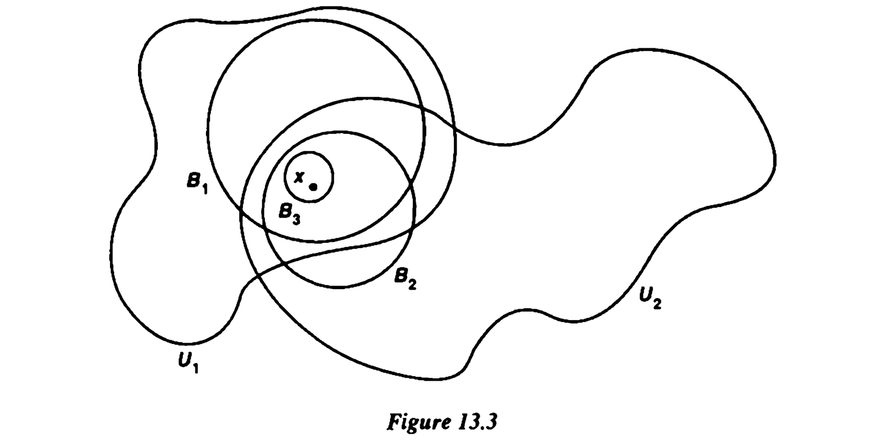
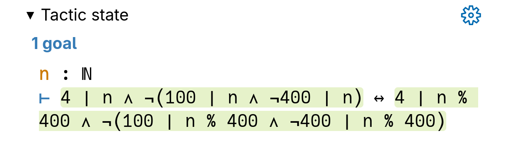

Don't be fooled by how popular Lean is getting with the AI crowd: proving stuff in it is heaps of fun even if you're a human being.

Lately I've been running a little "math book club" where we read a topology textbook together and share our thoughts. Some of the group members are software folks or other nerds who never got into the proof-y side of mathematics. A common question in the chat has been: "I *think* I solved this exercise, but is this really a proof?"

A proof is a bit of rhetoric that aims to convince any reasonable, critical mathematician — and how do you know you're doing it right if you're still trying to *become* a reasonable, critical mathematician?



I think this is an unsung strength of theorem provers like Lean. The goal of proof-writing is, obviously, much more black-and-white when working in Lean. It reads your proof and either tells you `Goals accomplished!` or shows precisely which holes remain in your argument. Admittedly, this can mean you're forced to get *really* into the weeds. (Satisfying the proof checker is a lot harder than satisfying a human reader, even if you know how to speak its language.) But it nicely breaks the awkwardness of being both the convincer and the one to be convinced... both the adventurer and the dungeon master.

I wouldn't be the first person to express the feeling that Lean turns all of mathematics into a kind of fractal puzzle game. Each theorem is a "level," or maybe a "campaign": you get to strategize about the big picture, slice it into lemmas, and knock each of them out for a little _tada_-emoji reward. It's addictive! I want to give you a short tour of what it's all like.

<div style="font-size:80%" markdown=1>(I am like 99% sure that it *really* used to print tada emojis when satisfied, but now it only shows them when I write `hint` and *it* happily finds a line of code that solves *my* problem. Change it back!!)
</div>

## Hello, Lean

Here's a ridiculous fact.

> Year *n* is a leap year iff gcd(*n*, 80) > gcd(*n*, 50).

I've proven this several different ways, and I encourage you to do the same. Today, we will take a rather uninspiring approach that plays to Lean's strengths. To start with, we'll define `leap_year`, a function from a natural number `n` to a proposition saying "`n` is a leap year":

```hs
import Mathlib

def leap_year (n : ℕ) : Prop := 4 ∣ n ∧ ¬ (100 ∣ n ∧ ¬ 400 ∣ n)
```

That says: define `leap_year n` as the claim that `n` is a multiple of 4, but *not* a multiple of 100 that isn't also a multiple of 400. (You can copy this into [Lean Web](https://live.lean-lang.org/) and follow along at home.)

Small aside: the `Mathlib` library is [Mathlib4](https://github.com/leanprover-community/mathlib4), a massive repository of mathematical objects and facts proven about them in Lean. The average fact in it looks something like, _any injective polynomial map `S → S` is also surjective on `S` if `K` is an algebraically closed field and `S` is a definable subset of `K^n`,_ and I feel pretty silly whenever I browse it to prove something extremely mundane. But it does also contain helpful facts about gcd, so we'll import it.

The fancy Unicode symbols `∣ ∧ ¬` mean: divides, and, not. That first one is `∣ U+2223 DIVIDES`, not the vertical bar on your keyboard. These are par for the course in Lean, and the Visual Studio Code extensions for Lean lets me input them using `\dvd \and \not`.

## Strategy and tactics

So, here is my relatively boring strategy: I'll prove that `n` is a leap year iff `n % 400` is a leap year; then I'll show that `n.gcd 80` equals `(n % 400).gcd 80` and also `n.gcd 50` equals `(n % 400).gcd 50`. (Yes, Lean has the funny habit of writing `a.gcd b` to mean `gcd(a, b)`.) That leaves us with 400 cases that are trivial to check one by one! It's not very enlightening, but it's convincing and straightforward.

We start with...

```hs
lemma leap_year_iff_leap_year_mod_400 {n : ℕ}
    : leap_year n ↔ leap_year (n % 400) := by
  sorry
```

When we write `by`, we enter "tactic mode", and now each line that follows specifies a "tactic", a kind of *move* that makes progress in our proof. For example, "perform induction on `n`" is a tactic, as is "apply contraposition" or "rewrite this hypothesis using such-and-such theorem from Mathlib."

For now, the tactic `sorry` means: "TODO: prove this." As in: *sorry, Lean, you'll just have to believe me*. And Lean says, *okay* — if you move your cursor from before the `sorry` to after the `sorry` you'll see the view on the right change from "1 goal" to "No goals." However the lemma's name gets marked with a squiggle: `declaration uses 'sorry'`.

Let's fill in the proof. We'll `unfold` the definition of `leap_year`:



This mess is a job for a helpful little tactic called `omega`, which excels at automatically proving this sort of statement. Its documentation begins

> The omega tactic, for resolving integer and natural linear arithmetic problems. It is not yet a full decision procedure (no "dark" or "grey" shadows), but should be effective on many problems.

I think this is fantastically mysterious and I hope I never learn what "dark" or "grey" shadows are. Whatever is going on inside `omega`, it does the trick!

```hs
lemma leap_year_iff_leap_year_mod_400 {n : ℕ}
    : leap_year n ↔ leap_year (n % 400) := by
  unfold leap_year
  omega
```

There are a few tactics like this in our arsenal. They mostly let us focus on the essential, without getting bogged down in straightforward "computational" facts that we know will have boring proofs: `omega` finds the boring proof for us.

## Goals and subgoals

Let me lead with the code for this next bit:

```hs
lemma gcd_eq_mod_gcd_of_dvd (m : ℕ) {n k : ℕ} (h : k ∣ m)
    : n.gcd k = (n % m).gcd k := by
  trans (n % m % k).gcd k
  · rw [Nat.mod_mod_of_dvd n h, Nat.gcd_comm, Nat.gcd_rec]
  · rw [←Nat.gcd_rec, Nat.gcd_comm]
```

We are proving that if `k` is a divisor of `m`, then `gcd(n, k)` equals `gcd(n % m, k)`. The proof starts with the `trans` tactic: transitivity! If our goal looks like...

```
n.gcd k = (n % m).gcd k
```

then we can type `trans e` to split it into two subgoals,

```
· n.gcd k = e
· e = (n % m).gcd k
```

which we then deal with by splitting our proof into two proofs, as well. I won't bother you with the details, but `rw` ("rewrite") uses existing equality or iff proofs to justifiedly rewrite parts of the goal. If the goal becomes trivial in the process, it is completed automatically.

By the way, there is an art, in the Lean world, to naming theorems in a predictable fashion so that other people (e.g. "future you") can find your theorem later. I think `gcd_eq_mod_gcd_of_dvd` adheres to convention, but I'm not an expert.

## Four. Hundred. Cases.

Here's the rest of our proof:

```hs
theorem leap_year_gcd {n : ℕ}
    : leap_year n ↔ n.gcd 80 > n.gcd 50 := by
  rw [leap_year_iff_leap_year_mod_400]
  rw [gcd_eq_mod_gcd_of_dvd 400 (by decide : 80 ∣ 400)]
  rw [gcd_eq_mod_gcd_of_dvd 400 (by decide : 50 ∣ 400)]
  unfold leap_year
  have h400 : n % 400 < 400 := by omega
  interval_cases n % 400 <;> aesop
```

We use `rw`, this time with our own lemmas. Our `gcd_eq_mod_gcd_of_dvd` wants a proof that 80 (and then 50) really *is* a divisor of 400, which we provide inline as `by decide` (i.e. telling Lean to punch it into a calculator and see). Then we `unfold` the definition of `leap_year` again, as before.

The key ingredient is `interval_cases`, which splits a goal into all possible values a bounded expression can assume. For example, if we are trying to prove `P(k)` for some integer `k`, and we have hypotheses saying `k > 1` and `k < 5`, then `interval_cases k` splits the goal into three subgoals: proving `P(2)`, proving `P(3)`, and proving `P(4)`.

In our case, we first prove that `n % 400 < 400` (easy with `omega`), and then we are ready for `interval_cases n % 400`.

The ensuing `<;>` is a *tactic combinator:* when we write `t <;> u` we mean "apply tactic `t`, then to each subgoal apply tactic `u`." This is useful if we do not want to write `· aesop` 400 times.

What is `aesop`, then? I have no idea, honestly! It's another little guy like `omega` that is good at proving stuff automatically. If neither of those works I might try `ring_nf`, or `grind`. These all coexist and have varying strengths and weaknesses, and honestly your best bet might be to run the `hint` tactic and see which one works.

Goals accomplished! That's Lean, baby!!
